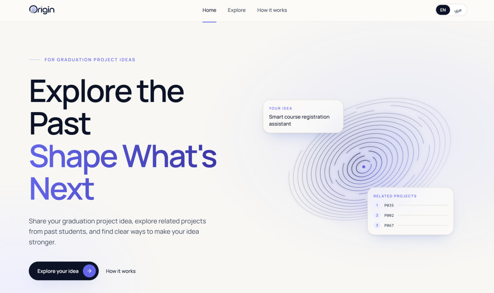
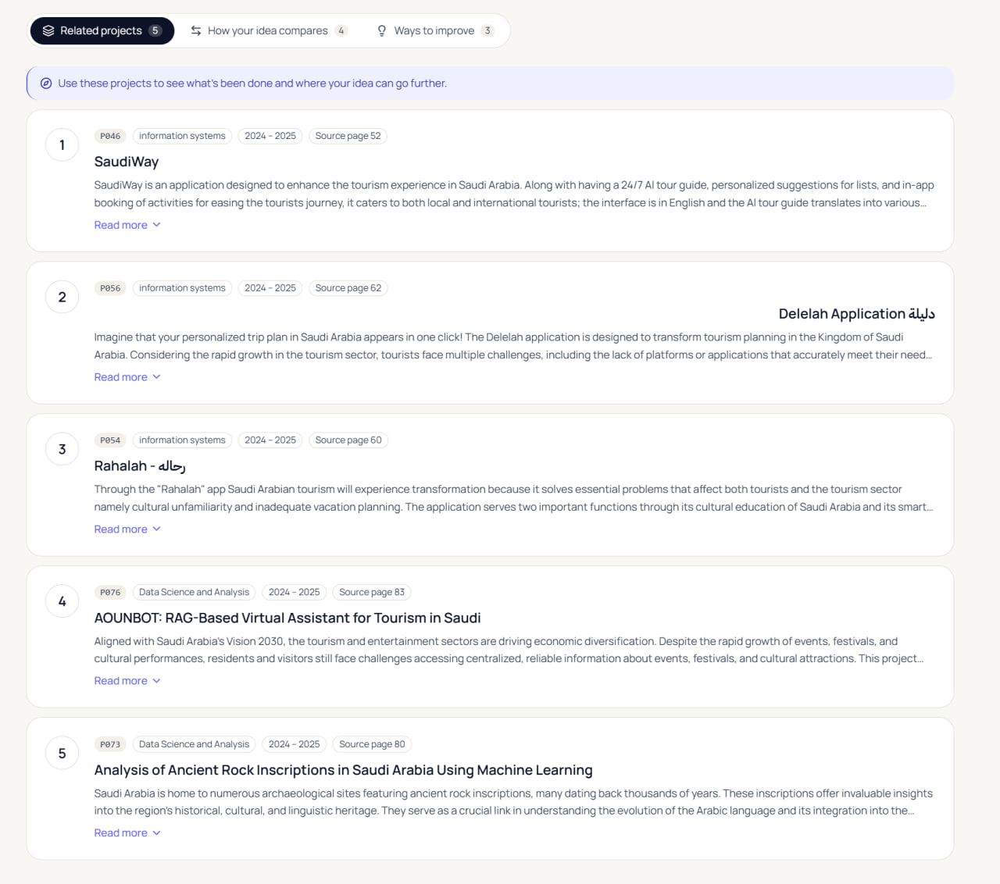
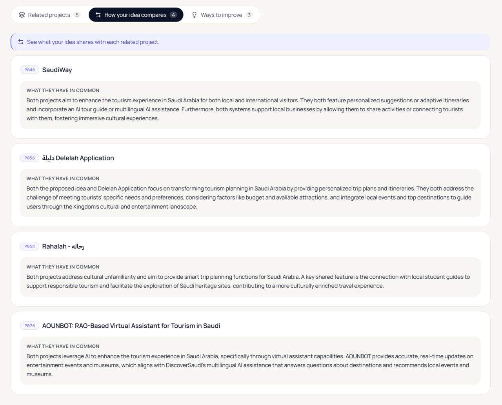
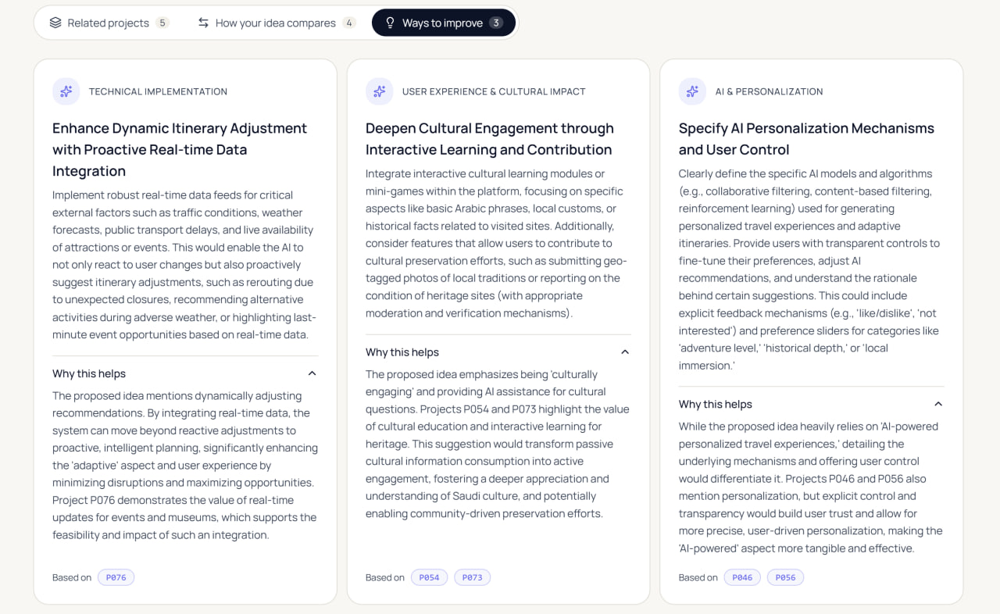
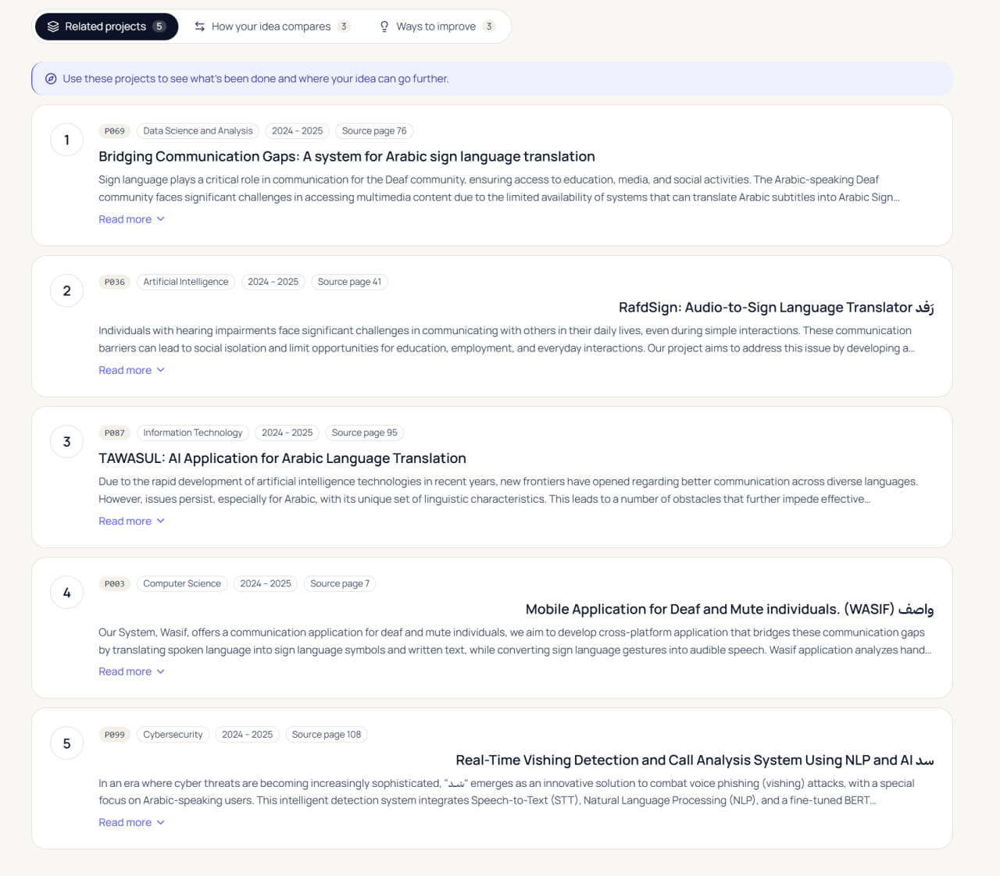

<div align="center">

# Origin

### Explore the Past. Shape What's Next.

**An AI-powered, bilingual platform for exploring graduation project ideas.**

Find relevant past projects, understand where your idea overlaps, and discover practical directions to make it stronger - in **Arabic or English**.

[Explore the Code](https://github.com/esrrahafase-crypto/Origin) · [How It Works](#how-origin-works) · [Run Locally](#run-origin-locally)

</div>



## The idea behind Origin

Coming up with a graduation project is exciting. Figuring out **what has already been explored**, and how to develop an idea beyond existing work, is harder.

Origin turns a collection of previous graduation projects into a searchable starting point. Students submit an idea in natural language, explore related projects from a curated archive, and receive AI-assisted comparisons and actionable improvement suggestions grounded in the retrieved records.

## What Origin does

| Explore | Compare | Evolve |
|:--|:--|:--|
| **Related Projects** - Retrieve up to five relevant historical projects with their IDs and source pages. | **How Your Idea Compares** - Explain evidence-supported similarities with selected retrieved projects. | **Ways to Improve** - Suggest practical directions to develop and differentiate the proposed idea. |

**Built for two languages.** Arabic queries use semantic retrieval; English queries use a hybrid of lexical and semantic retrieval with Reciprocal Rank Fusion (RRF). The interface also supports Arabic right-to-left layout.

## See Origin in action

### English case study - DiscoverSaudi

**Input:** *DiscoverSaudi: AI-Powered Personalized Tourism and Cultural Experience Planner*

The proposed idea combines personalized Saudi travel itineraries, cultural discovery, local experiences, and multilingual assistance.

**1. Discover relevant work**

Origin retrieved five projects, with the four preselected tourism-related references appearing in the first four positions: **P046 (SaudiWay), P056 (Delelah), P054 (Rahalah), and P076 (AOUNBOT)**.



**2. Understand the overlap**

The system generated four comparisons tied to those retrieved projects, highlighting shared features such as personalized recommendations, trip planning, local guides, and AI-powered tourist assistance.



**3. Identify opportunities to improve**

Origin proposed three directions: proactive itinerary adjustments using real-time data, deeper cultural engagement, and more transparent personalization with user controls. The interface provides a rationale and project references where applicable.



### Arabic case study - Saudi Sign Language university assistant

**Input:** *وصال | مساعد ذكي للتواصل بلغة الإشارة السعودية داخل الجامعات*

The Arabic-language idea explores two-way communication between Deaf or hard-of-hearing students and university staff through sign recognition and text-to-sign assistance.

In this example, all three preselected related references - **P069, P036, and P003** - appeared within the five retrieved projects. Origin also produced three comparisons and three improvement suggestions.



*These are illustrative, real application runs. Their reference coverage is specific to the selected case studies and should not be interpreted as a corpus-wide accuracy score.*

## How Origin works

```text
Your idea (Arabic or English)
             │
             ▼
Language-aware retrieval
  ├─ Arabic: multilingual semantic search
  └─ English: BM25 + semantic search → RRF
             │
             ▼
Top related projects from a 103-project archive
             │
             ├──────────────────────────┐
             ▼                          ▼
Related projects                Gemini RAG enhancement
(real records + source pages)    (grounded comparisons + suggestions)
             │                          │
             └──────────────┬───────────┘
                            ▼
                  Bilingual web interface
```

The retrieval implementation uses `sentence-transformers/paraphrase-multilingual-mpnet-base-v2`. A **FastAPI** backend serves the results to a **React + TypeScript** frontend. Gemini is used for optional, evidence-grounded enhancement, not for generating substitute project records.

If Gemini is unavailable, the application **still returns real retrieval results** and clearly indicates that enhancement could not be completed.

## Technology

| Layer | Tools and methods |
|:--|:--|
| Frontend | React, TypeScript, Vite, TanStack Router, Tailwind CSS |
| Backend | Python, FastAPI, Pydantic |
| Retrieval | Sentence Transformers, BM25, semantic similarity, RRF |
| AI enhancement | Google Gemini API, retrieval-augmented generation (RAG) |
| Research and evaluation | Jupyter notebooks, pandas, scikit-learn |

## Dataset and evaluation

Origin currently searches **103 historical graduation projects** curated into a structured dataset. It includes research notebooks documenting the preparation, retrieval experiments, and evaluation process.

- **Dataset:** [`data/processed/projects_clean.csv`](data/processed/projects_clean.csv)
- **Evaluation queries:** [`data/evaluation/evaluation_queries.csv`](data/evaluation/evaluation_queries.csv)
- **Research notebooks:** [`notebooks/`](notebooks/)
- **Evaluation outputs:** [`results/`](results/)

The two case studies above demonstrate expected matches in Arabic and English, but they are not a substitute for aggregate retrieval metrics. See the evaluation artifacts for the broader experimental results.

## Run Origin locally

Origin is a **local application**, not a hosted demo. The frontend and backend run in separate terminals. You will need **Python 3.12**, **Node.js 22+**, Git, and an internet connection for initial installation and model download. The first model download requires approximately **2 GB of free disk space**.

### 1. Clone the repository

```powershell
git clone https://github.com/esrrahafase-crypto/Origin.git
cd Origin
```

### 2. Set up and start the backend

In the first PowerShell terminal:

```powershell
py -3.12 -m venv .venv
.\.venv\Scripts\python.exe -m pip install -r requirements-api.txt
Copy-Item .\.env.example .\.env
```

Edit `.env` locally and set `GEMINI_API_KEY` to your own key if you want AI-generated comparisons and suggestions. **Never commit your key.** Retrieval remains available without Gemini enhancement.

```powershell
.\.venv\Scripts\python.exe -m uvicorn src.api:app --host 127.0.0.1 --port 8000 --workers 1
```

### 3. Set up and start the frontend

In a second PowerShell terminal, from the repository root:

```powershell
cd frontend
npm.cmd ci
npm.cmd run dev -- --host localhost --port 5173 --strictPort
```

Open **http://localhost:5173**. Backend health: **http://127.0.0.1:8000/health**. API documentation: **http://127.0.0.1:8000/docs**.

On the first analysis, the embedding model is downloaded into a local cache and may take a few minutes to initialize on CPU.

### Run tests

Backend (from the repository root):

```powershell
.\.venv\Scripts\python.exe -m pip install -r requirements-test.txt
.\.venv\Scripts\python.exe -m pytest -q
```

Frontend (from `frontend/`):

```powershell
npm.cmd test
npm.cmd run typecheck
npm.cmd run build
```

Gemini calls in automated backend contract tests are mocked; they do not consume API quota.

## Repository at a glance

```text
Origin/
├── frontend/             React/TypeScript application and UI tests
├── src/                  FastAPI backend and retrieval pipeline
├── data/                 Project dataset and evaluation queries
├── notebooks/            Research notebooks 01–09
├── results/              Retrieval evaluation outputs
├── figures/              Research visualizations
├── tests/                Backend contract tests
├── docs/                 API documentation and README screenshots
├── requirements-api.txt  Runtime Python dependencies
├── requirements-test.txt Test dependencies
└── README.md
```

## Scope and future directions

Origin is a research-backed prototype. Its relevance is bounded by the included archive; comparisons describe supported similarities rather than proving originality. Gemini availability, quotas, and generated-text quality may vary.

Potential next steps include expanding the historical corpus, adding filters by year and department, improving explanations of ranking results, and conducting structured user evaluations with students and supervisors.

## Meet the Team

Origin was developed collaboratively by a team of Artificial Intelligence students.

| Team Member | Role | GitHub |
| --- | --- | --- |
| Rahaf Saadeddin | Team Leader | [@soyrahaf](https://github.com/esrrahafase-crypto) |
| Maram Alhajri | Team Member | [@vmmci](https://github.com/vmmci) |
| Renad Hazazi | Team Member | [@RENADBHAI](https://github.com/RENADBHAI) |
| Ghala Hazazi | Team Member | [@Ghalaxxx](https://github.com/Ghalaxxx) |

---

<div align="center">

**Origin** - *Explore the Past. Shape What's Next.*

Built by the **Origin team**.

</div>
